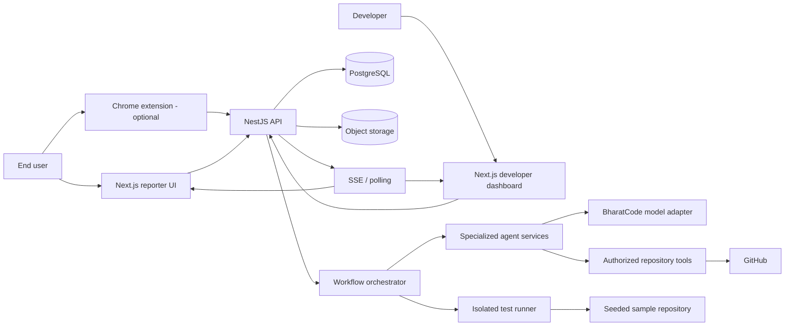
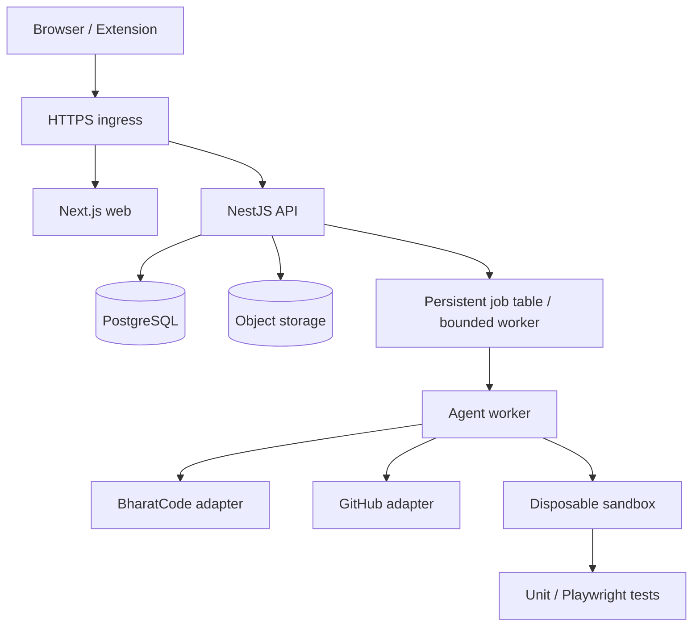
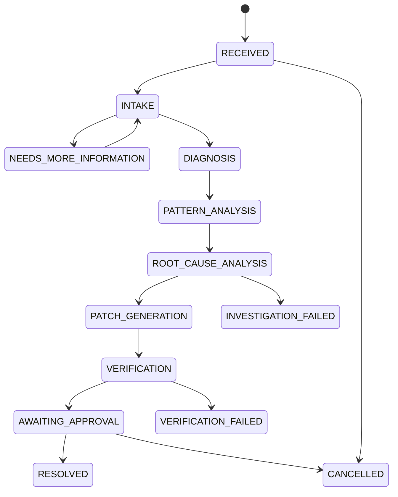
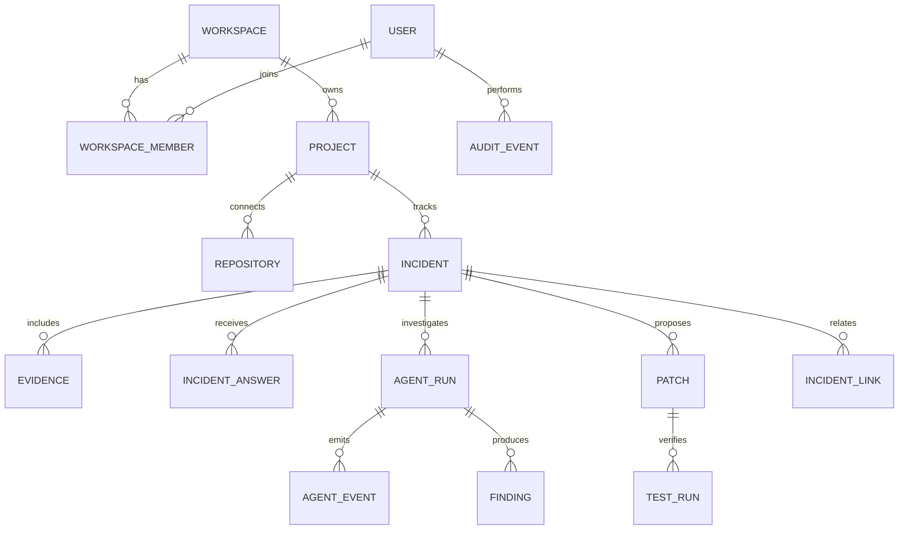

# ReproLoop — Technical Requirements Document (TRD)

**Document status:** Baseline implementation specification  
**Version:** 1.0  
**Last updated:** 7 November 2026

---

## 1. Purpose

This document defines the technical baseline, integrations, data model, interfaces, runtime behavior, security boundaries, and operational requirements for ReproLoop. It is intended to guide implementation and future maintenance. Where a provider capability is not verified, it is explicitly marked as an assumption or decision gate.

## 2. Architecture principles

1. **Evidence before inference:** agents may interpret supplied evidence but cannot manufacture it.
2. **Backend owns authority:** model output never directly grants permissions or executes arbitrary actions.
3. **Human approval before code changes leave the sandbox:** no automatic merge/deployment in MVP.
4. **Persist before stream:** progress events are durable before being sent to clients.
5. **Least privilege:** user, workspace, repository, and tool access are scoped.
6. **Modular monolith first:** avoid microservices until measured scaling or team boundaries justify them.
7. **Provider portability:** model, hosting, storage, and execution services sit behind adapters.
8. **Reproducibility:** every patch and verification record is tied to a repository revision and environment.

## 3. Proposed technology stack

| Layer | Baseline | Reason / constraint |
|---|---|---|
| Web app | Next.js + TypeScript + Tailwind CSS | Fast product UI and server-rendered routes |
| API | NestJS + TypeScript | Modular backend and typed services |
| Database | PostgreSQL | Relational incident/workspace/audit data |
| ORM | TypeORM | Aligns with existing NestJS/PostgreSQL experience; avoid adding a second ORM |
| Validation | Zod or class-validator (choose one per boundary) | Validate API and agent contracts consistently |
| AI orchestration | Backend-owned state machine | Predictable control, bounded execution, auditability |
| Model inference | BharatCode API via provider adapter | Hackathon model requirement; verify API contract |
| Optional model development | Adaption credits advertised by BharatCode for project model training | Verify account grant and exact eligible Adaption product; not assumed to cover inference/hosting |
| Repository integration | GitHub App or narrowly scoped OAuth | Least-privilege repository access |
| Browser extension | Chrome Manifest V3 + TypeScript | Optional evidence capture |
| Browser automation | Playwright | Reproduction and regression tests |
| Live progress | SSE or polling | SSE is suitable for one-way server-to-client updates |
| File storage | S3-compatible object storage or provider storage | Store screenshots/log bundles outside relational rows |
| Testing | Jest (NestJS), Playwright (E2E), unit tests | Validate service logic and user-facing flow |

Do not add Redis, Kafka, Kubernetes, vector databases, or microservices solely to make the architecture appear advanced. Add them only when a specific requirement justifies them.

## 4. System context



## 5. Deployment topology

### MVP topology

A single deployable web application, a single API service, PostgreSQL, object storage, and a separate isolated test-runner boundary. The test runner must not share the API process or its credentials.



A database-backed job table is acceptable for the MVP if implemented with locking, retries, and idempotency. If a managed queue is available through AdaptionLabs credits and its operational value is clear, evaluate it; do not assume that it is included.

## 6. Repository layout

```text
reproloop/
├── apps/
│   ├── web/                         # Next.js application
│   ├── api/                         # NestJS application
│   │   └── src/
│   │       ├── auth/
│   │       ├── users/
│   │       ├── workspaces/
│   │       ├── projects/
│   │       ├── incidents/
│   │       ├── evidence/
│   │       ├── repositories/
│   │       ├── ai/
│   │       │   ├── agents/
│   │       │   ├── orchestrator/
│   │       │   ├── tools/
│   │       │   ├── prompts/
│   │       │   └── providers/
│   │       ├── patches/
│   │       ├── verification/
│   │       ├── audit/
│   │       └── database/
│   └── extension/                   # Manifest V3 extension (P1)
├── packages/
│   ├── shared-types/
│   ├── validation/
│   └── agent-contracts/
├── sample-repository/               # Deterministic buggy application
├── docs/
│   ├── PRD.md
│   ├── TRD.md
│   └── UIUX-Architecture-Development-Specifications.md
├── .env.example
├── README.md
└── package.json
```

## 7. Backend modules and responsibilities

| Module | Responsibility |
|---|---|
| AuthModule | Authentication, session/JWT lifecycle, authorization guards |
| UsersModule | User profile and account operations |
| WorkspacesModule | Workspace membership and role checks |
| ProjectsModule | Project metadata and repository association |
| IncidentsModule | Incident lifecycle, status transitions, reporter/developer views |
| EvidenceModule | Upload validation, metadata, redaction, access control |
| RepositoriesModule | GitHub authorization, repository metadata, revision pinning |
| AiModule | Model adapter, agent execution, prompt/version management |
| OrchestratorModule | Workflow state machine, job persistence, retries, cancellation |
| PatchesModule | Diff storage, patch validation, review status |
| VerificationModule | Sandbox requests, test execution records, output capture |
| AuditModule | Immutable or append-only security-sensitive event history |

## 8. Agent contracts

All agent inputs and outputs must be validated JSON objects. Use shared TypeScript schemas and version them. Example contract shapes:

```ts
type AgentStatus =
  | "completed"
  | "needs_input"
  | "failed"
  | "timed_out";

type FindingKind =
  | "observation"
  | "hypothesis"
  | "recommendation"
  | "verified_result";

interface EvidenceReference {
  type: "incident_evidence" | "repository_location" | "test_run";
  id?: string;
  path?: string;
  lineStart?: number;
  lineEnd?: number;
  description: string;
}

interface AgentFinding {
  title: string;
  kind: FindingKind;
  summary: string;
  confidence: number; // 0..1, not a calibrated probability unless calibrated
  evidence: EvidenceReference[];
  limitations: string[];
}

interface AgentRunResult {
  status: AgentStatus;
  summary: string;
  findings: AgentFinding[];
  questions?: string[];
  toolRequests?: ToolRequest[];
}
```

### Agent-specific output requirements

- Intake: normalized report, expected behavior, actual behavior, reproduction steps, missing fields, follow-up questions.
- Diagnostic: extracted observations with source references and timestamps.
- Pattern: candidate incident IDs, matching dimensions, similarity rationale.
- Root cause: ranked hypotheses, repository references, counter-evidence, confidence limitations.
- Repair: patch diff, affected files, rationale, test plan, risk notes.
- Verification: status, patch hash, repository revision, environment, commands, exit codes, logs, timestamps.

## 9. Orchestration and workflow state

### State machine



### Orchestrator rules

- Store `current_state`, `version`, `attempt_count`, `started_at`, and `updated_at`.
- Use optimistic locking or row-level locking to prevent concurrent duplicate transitions.
- Each job has an idempotency key.
- Define per-agent timeout, total workflow deadline, retry ceiling, and maximum tool calls.
- Retry transient provider/network errors only; do not retry invalid output indefinitely.
- A model response cannot transition the workflow without backend validation.
- Cancellation must stop queued work and signal active workers.
- Record prompt version, model identifier, provider request ID (if returned), token/usage metadata (if available), and sanitized error details.

## 10. Tool registry and permissions

Tools are backend functions with explicit input schemas and authorization checks. The model may request a tool; it cannot execute one directly.

| Tool | Purpose | Permission / safety |
|---|---|---|
| get_incident | Load incident context | Incident/workspace authorization |
| get_browser_evidence | Read permitted diagnostic metadata | Redacted, incident-scoped |
| search_similar_incidents | Candidate duplicate search | Workspace/project scope |
| search_repository | Search authorized repo | Repository allowlist |
| read_file | Read bounded file range | Path validation; no traversal |
| search_symbol | Locate definitions/references | Repo-scoped |
| get_git_diff | Read current proposed diff | Patch owner/reviewer authorization |
| create_patch | Create isolated patch artifact | Sandbox workspace only |
| generate_test | Draft test file/plan | Allowed paths and file types |
| run_unit_tests | Execute predefined test command | Isolated runner only |
| run_playwright_test | Run approved browser test | Isolated runner, bounded resources |
| submit_for_review | Mark patch ready for review | Developer authorization |

**Do not expose a general-purpose shell tool to the model.** Use predefined command templates and a sandbox policy. Reject arbitrary URLs, arbitrary file paths, shell metacharacter injection, and commands outside the allowlist.

## 11. API requirements

Prefix: `/api/v1`

| Method | Endpoint | Purpose |
|---|---|---|
| POST | `/auth/register` | Register user (if auth is in MVP) |
| POST | `/auth/login` | Authenticate user |
| GET | `/workspaces` | List accessible workspaces |
| POST | `/projects` | Create project |
| GET | `/projects/:projectId` | Project details |
| POST | `/incidents` | Create incident |
| GET | `/incidents` | List scoped incidents |
| GET | `/incidents/:incidentId` | Incident details |
| POST | `/incidents/:incidentId/evidence` | Attach evidence |
| POST | `/incidents/:incidentId/answers` | Submit follow-up answers |
| POST | `/incidents/:incidentId/investigations` | Start investigation |
| GET | `/incidents/:incidentId/events` | Fetch persisted timeline |
| GET | `/incidents/:incidentId/stream` | SSE progress stream |
| POST | `/repositories/connect` | Connect authorized repository |
| GET | `/repositories/:repositoryId` | Repository metadata |
| GET | `/incidents/:incidentId/patches` | List proposed patches |
| POST | `/incidents/:incidentId/patches` | Create proposed patch |
| POST | `/patches/:patchId/verify` | Request verification |
| POST | `/patches/:patchId/approve` | Approve patch |
| POST | `/patches/:patchId/reject` | Reject patch |

Every endpoint must enforce authentication (where applicable), workspace membership, project scope, and resource ownership. Avoid trusting a client-supplied workspace ID without membership validation.

## 12. Data model

Core entities:

- `User`
- `Workspace`
- `WorkspaceMember`
- `Project`
- `Repository`
- `Incident`
- `Evidence`
- `IncidentAnswer`
- `AgentRun`
- `AgentEvent`
- `Finding`
- `Patch`
- `TestRun`
- `IncidentLink`
- `AuditEvent`

### Key relationships



### Data requirements

- Every workspace-owned record includes `workspace_id`.
- Enforce foreign keys and indexes for common list/filter paths.
- Store screenshot/log binaries in object storage; DB stores object key, checksum, MIME type, size, uploader, consent reference, and timestamps.
- Store patch content as a bounded diff or object reference, plus base commit SHA and patch hash.
- Store test output with size limits and redaction.
- Use soft deletion only where audit/retention policy requires it; define hard deletion for user-requested data deletion.
- Add `created_at`, `updated_at`, and where needed `deleted_at`.
- Use UTC timestamps in storage; render local time in UI.

## 13. Model provider integration

### Provider adapter

Create a stable internal interface:

```ts
interface ModelProvider {
  generate(input: {
    system: string;
    messages: Array<{ role: "user" | "assistant"; content: unknown }>;
    responseSchema?: unknown;
    temperature?: number;
    maxOutputTokens?: number;
  }): Promise<{
    text: string;
    structuredOutput?: unknown;
    model: string;
    requestId?: string;
    usage?: { inputTokens?: number; outputTokens?: number };
  }>;
}
```

Implement `BharatCodeProvider` behind this interface. Do not hard-code provider-specific request assumptions throughout agent code.

### BharatCode verification gate

Before implementation is locked, verify from current official documentation or a successful minimal API test:

- Current base URL and API version.
- Exact model identifier and availability.
- Authentication header format.
- Whether the endpoint is Chat Completions, Responses, or another API.
- Supported input modalities (text/image), structured output, tool calling, and streaming.
- Context/output limits, rate limits, timeouts, usage reporting, and error format.
- Data retention/training terms and applicable privacy constraints.
- Whether the hackathon requires a particular model or evidence of model usage.

Do not assume OpenAI SDK compatibility, endpoint paths, `store` behavior, or model names until tested. Keep API keys server-side in environment secrets. Never put a key in Next.js public variables, browser code, extension bundles, Git, logs, or screenshots.

## 14. AdaptionLabs.ai credits: resource evaluation

The user reports receiving Adaption credits through the hackathon. The official BharatCode Build League page advertises **1,000 free Adaption credits per participant to train a model for the project**. The grant shown on the event page should not be interpreted as general-purpose cloud, inference, database, or hosting credit.

### Required credit audit before selecting services

Record the following in `docs/credits-and-provider-decisions.md` (or the project decision log):

| Field | Value to confirm |
|---|---|
| Credit amount and currency | Event page advertises 1,000 Adaption credits per participant; confirm the user's actual account balance |
| Expiry date/time and timezone | Unknown |
| Eligible products/services | Event page describes model training; exact Adaption product eligibility must be confirmed in account/docs |
| Usage rates and billing units | Unknown |
| Region availability | Unknown |
| API access / quotas | Unknown |
| Data retention and privacy terms | Unknown |
| Overages after credits expire | Unknown |
| Whether credits are personal or project/team scoped | Unknown |
| Support/contact and service limits | Unknown |

### Decision policy

1. Inspect the official dashboard/terms; do not infer what “free credits” cover.
2. Map eligible services to concrete needs: model inference, app hosting, database, object storage, background jobs, logs/monitoring.
3. Compare reliability, setup time, limits, region, pricing after credits, and lock-in.
4. Use credits for a service only if it reduces delivery risk or cost without adding disproportionate integration work.
5. Keep provider adapters and environment-based configuration so the app can move later.
6. Set budget alerts/usage caps where supported.
7. Do not place secrets or user evidence in a provider until its security and data terms are reviewed.
8. Record the decision, date, assumptions, and exit path.

**Default recommendation:** first inspect whether the grant is for Adaption's model-training workflow and whether it has an expiry. Do not spend hackathon time training a custom model by default: use the required BharatCode inference API for the MVP. Consider Adaption training only if it can materially improve a narrowly defined capability (for example, classifying incident categories) and there is enough labelled data, evaluation time, and a deployment path. Do not assume the credits cover inference, hosting, database, or managed execution.

## 15. Browser extension technical requirements

Manifest V3, TypeScript. Extension is P1 and should be cut if it threatens the verified end-to-end demo.

- Baseline permissions: `activeTab`, `storage`; request additional permissions only for a demonstrated need.
- Capture: current tab URL/title, user-selected screenshot, and explicitly permitted diagnostic metadata.
- Do not claim that content scripts can read the DevTools console history; they cannot.
- `chrome.webRequest` may provide limited request metadata subject to permission and browser policy; it does not grant access to sensitive request/response bodies.
- Do not capture cookies, credentials, authorization headers, full browsing history, passwords, or payment details.
- Show capture state and preview what will be sent.
- Redact URL query parameters and sensitive identifiers before upload.
- Support manual report entry if extension permissions are denied or the page is restricted.
- Treat browser extension data as untrusted input.

## 16. Verification sandbox requirements

- Use disposable workspaces/containers/VMs per verification job.
- Pin the base repository revision and patch hash.
- No production credentials or host filesystem mounts.
- CPU, memory, disk, process-count, and wall-clock limits.
- Network disabled by default; allowlist only when a test requires it.
- Predefined commands per supported sample project; no arbitrary model-generated shell.
- Capture stdout/stderr with output-size limits and secret redaction.
- Destroy environment after completion; retain only required artifacts and logs.
- Record environment image/version, dependencies, command, exit code, start/end time, and status.
- Distinguish test failure from runner failure and inconclusive execution.

## 17. Security and privacy controls

- TLS for all external traffic.
- Strong authentication and server-side authorization.
- Workspace isolation and tenant-scoped queries.
- Encrypt repository tokens and sensitive data at rest.
- Rotate/revoke tokens; least-privilege GitHub access.
- Validate uploads by content and size; scan where practical.
- Protect against path traversal, SSRF, command injection, XSS, CSRF, and IDOR.
- Treat model prompts, issue text, screenshots OCR, repository content, logs, and tool output as untrusted.
- Never let prompt text override backend authorization or tool policy.
- Use structured logging with secrets and sensitive content redacted.
- Rate-limit report submission, uploads, and investigation requests.
- Maintain audit records for repository connection, patch approval, and data access.

## 18. Observability and reliability

Log:
- Request ID, workspace/project/incident IDs.
- Workflow transition and event IDs.
- Agent name, run ID, prompt version, provider/model, duration, sanitized error.
- Tool name, validated arguments summary, result status.
- Patch hash, base commit SHA, test-run ID and status.

Do not log full prompts, private screenshots, secrets, raw headers, or unredacted network data by default.

Operational expectations:
- Health/readiness endpoints.
- Graceful handling of model provider outages.
- Idempotent job handling.
- Bounded retries and exponential backoff for transient failures.
- Dead-letter or failed-job visibility.
- Database migrations checked into source control.
- Backup and restore plan before production use.

## 19. Environment variables

Example names only; actual values belong in local environment or deployment secret manager:

```env
NODE_ENV=development
DATABASE_URL=
JWT_SECRET=
BHARATCODE_API_KEY=
BHARATCODE_BASE_URL=
BHARATCODE_MODEL=
GITHUB_APP_ID=
GITHUB_PRIVATE_KEY=
GITHUB_WEBHOOK_SECRET=
OBJECT_STORAGE_ENDPOINT=
OBJECT_STORAGE_BUCKET=
OBJECT_STORAGE_ACCESS_KEY=
OBJECT_STORAGE_SECRET_KEY=
WEB_ORIGIN=
API_PUBLIC_URL=
```

Do not commit `.env`, private keys, access tokens, or real secrets. Commit `.env.example` with empty values and descriptions.

## 20. Testing strategy

- Unit: validation, authorization, state transitions, redaction, provider adapter parsing.
- Integration: database persistence, repository adapter, model adapter, upload access control.
- Contract: every agent output schema and tool input schema.
- E2E: reporter submits seeded incident; investigation creates findings; patch is generated; test runner verifies; developer approves.
- Security: workspace isolation, IDOR, path traversal, prompt injection, upload validation, secret redaction.
- Failure tests: model timeout, invalid JSON, duplicate job, cancellation, sandbox crash, test failure.

## 21. Definition of done

A feature is complete only when:
- Requirements and acceptance criteria are met.
- Inputs and outputs are validated.
- Authorization and workspace scoping are enforced.
- Errors and loading states are handled.
- Tests cover core and failure paths.
- Logs do not expose secrets or private evidence.
- Documentation and environment examples are updated.
- No unverified success claim is displayed to users.

## 22. Architecture decision records (ADRs)

Create one short ADR per material choice:

- ADR-001: Modular monolith for hackathon MVP.
- ADR-002: TypeORM + PostgreSQL.
- ADR-003: Provider adapter for BharatCode and other model backends.
- ADR-004: Backend-controlled agent orchestration and tool registry.
- ADR-005: Isolated verification runner with no unrestricted shell.
- ADR-006: Consent-based minimal browser diagnostics.
- ADR-007: AdaptionLabs credit usage decision after eligibility audit.

Each ADR should state context, decision, alternatives, consequences, date, and owner.
